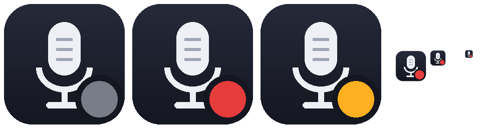

# Grabador de calls de Teams

Detecta cuándo estás en una llamada de Microsoft Teams y graba solo el audio de
la call **y** tu micrófono, sin OBS. Vive en la bandeja del sistema y no molesta.



- ⚪ **gris** — esperando una call
- 🔴 **rojo** — grabando
- 🟠 **ámbar** — detección pausada

Al cortar la call deja `Videos\Calls\<fecha hora>.mp3` (las dos voces mezcladas)
y las pistas sueltas en `Videos\Calls\pistas\` (`mic.flac` y `call.flac`), útiles
para separar quién dijo qué al transcribir.

## Cómo funciona

- **Detección:** revisa las sesiones de audio de Windows cada 2 s. Si un proceso
  de Teams está capturando de un micrófono, hay call. Arranca a los 3 s y corta
  15 s después de que Teams suelta el micrófono. El mute de Teams no corta la
  grabación.
- **Teams no siempre suelta el micrófono al colgar** (puede quedarse horas con
  él abierto). Por eso, si pasan **5 minutos sin audio del otro lado**, la call
  se da por terminada: se guarda hasta 30 s después del último audio de la call
  y lo grabado después se descarta. Se vuelve a armar cuando Teams suelta el
  micrófono o cuando vuelve a sonar algo por Teams (otra call).
- **Dispositivos:** graba los mismos que usa Teams (sirve con micrófonos
  virtuales como NVIDIA Broadcast), no los predeterminados de Windows.
- **Audio de la call:** WASAPI loopback de la salida que usa Teams. Como el
  loopback no entrega nada mientras no suena nada, cada pista se rellena con
  silencio contra el reloj para que las dos queden alineadas.
- **Mezcla:** ffmpeg, al terminar.

## Menú (clic derecho en el ícono)

- Detectar calls de Teams (on/off)
- Grabar ahora / Detener grabación — para grabar a mano
- Abrir carpeta de grabaciones
- Transcribir la última — opcional, ver abajo
- Salir — si está grabando, cierra el archivo antes de salir

## Requisitos

- Windows 10/11
- [ffmpeg](https://ffmpeg.org/) en el `PATH`
- Para correr desde el código: Python 3.10+ y `pip install -r requirements.txt`

## Uso

```powershell
pythonw grabador_calls.py
```

o compilar el `.exe` (queda en `dist\GrabadorCalls.exe`):

```powershell
.\build.ps1
```

Para que arranque con Windows: un acceso directo al `.exe` en
`shell:startup`.

El registro queda en `%LOCALAPPDATA%\GrabadorCalls\grabador_calls.log`.

## Transcribir (opcional)

Si la variable de entorno `WHISPERX340_DIR` apunta a un proyecto de
WhisperX340, el menú "Transcribir la última" lo corre con `uv` sobre el último
mp3, con separación de hablantes.

## Limitaciones

- Si entrás a una reunión con el micrófono desactivado desde antes, no la
  detecta: usá "Grabar ahora".
- Si cambiás de auriculares en medio de la call, la pista de la call sigue en
  el dispositivo anterior.
- Si en una call hablás solo vos más de 5 minutos seguidos (los demás
  callados), se corta: lo que digas después de esos 5 minutos se pierde.
- Teams no avisa a los demás de esta grabación. Avisá vos que estás grabando.

---

By BrianX340
